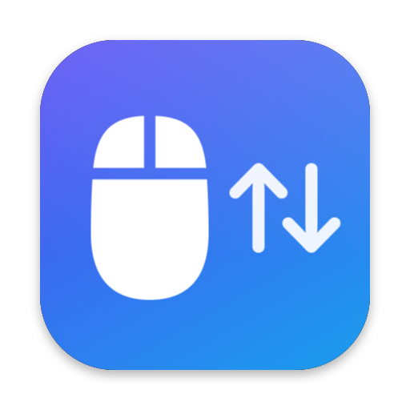
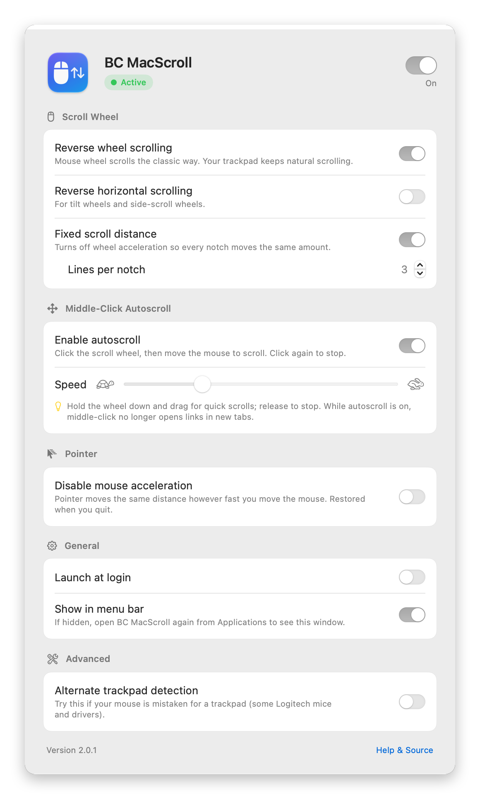
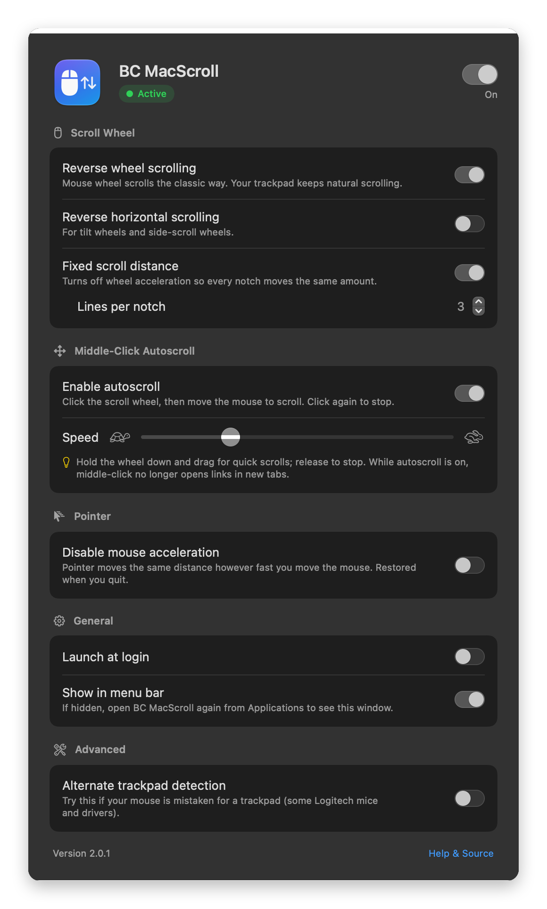
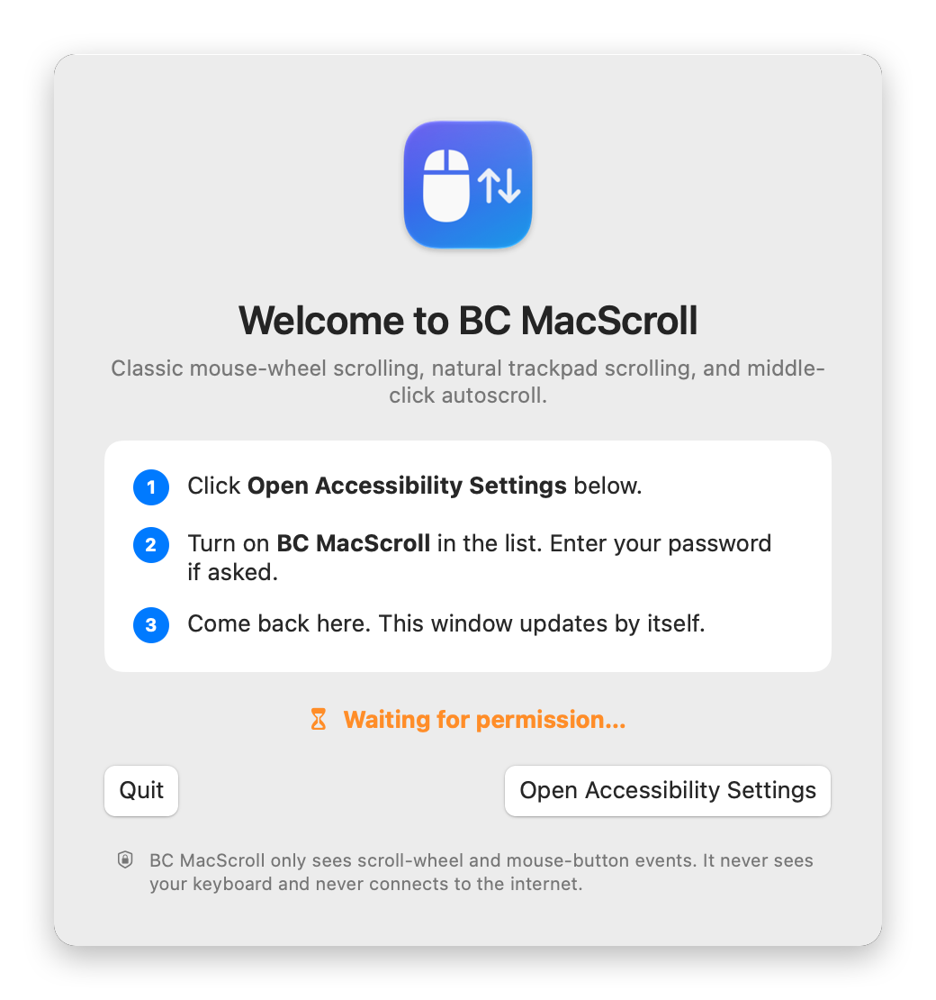
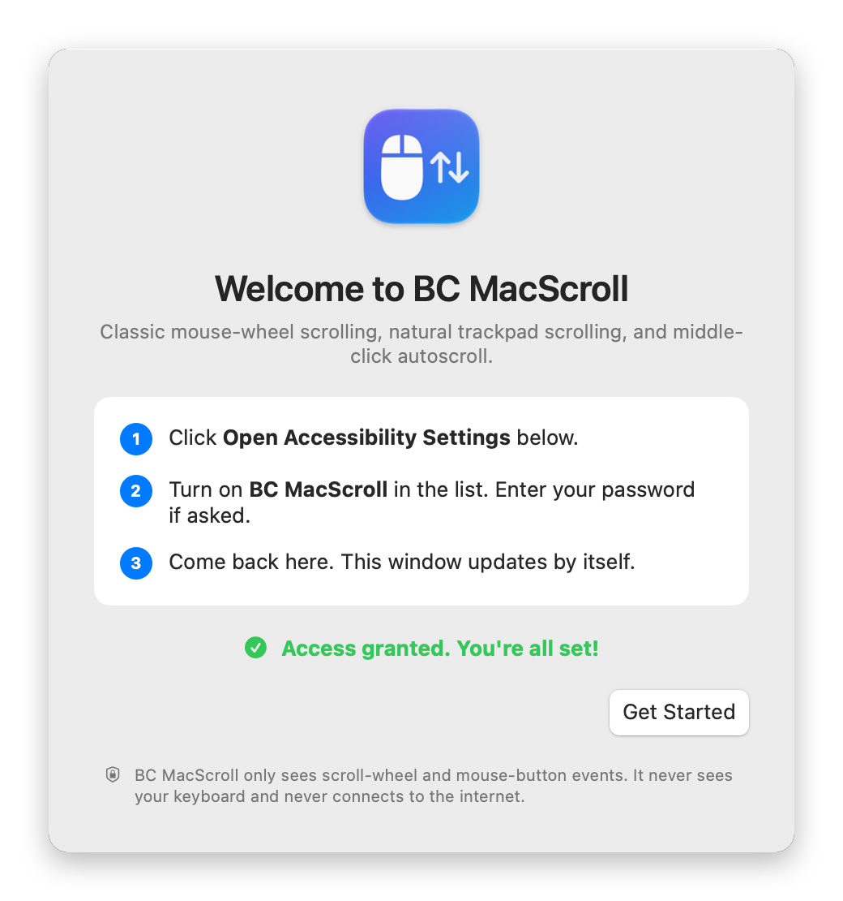

<p align="center">
  
</p>

<h1 align="center">BC MacScroll</h1>

<p align="center">
  <b>Classic mouse-wheel scrolling, natural trackpad scrolling, and Windows-style middle-click autoscroll for macOS.</b><br>
  A tiny menu bar app. No internet access, no keyboard access, free and open source.
</p>

<p align="center">
  <a href="../../releases/latest">Download</a> ·
  <a href="#install">Install</a> ·
  <a href="#middle-click-autoscroll">Autoscroll</a> ·
  <a href="#privacy--security">Privacy</a> ·
  <a href="#build-from-source">Build</a>
</p>

---

macOS uses a single "natural scrolling" setting for every device. That feels right on a trackpad and
backwards on a mouse wheel. **BC MacScroll** reverses only the mouse wheel, so you can keep
natural scrolling on the trackpad and classic scrolling on the mouse. It also adds
**middle-click autoscroll**: click the scroll wheel, then move the mouse to glide through long pages.

<p align="center">
  
  
</p>

## Features

| | |
|---|---|
| 🖱️ **Reverse wheel scrolling** | Mouse wheel scrolls the classic way. Trackpad and Magic Mouse keep natural scrolling. |
| ↔️ **Reverse horizontal scrolling** | Optional, for tilt wheels and thumb wheels. |
| 📏 **Fixed scroll distance** | Turns off wheel acceleration. Every notch moves 1–20 lines, your choice. |
| 🧭 **Middle-click autoscroll** | Click the wheel and move the mouse to scroll in any direction. Adjustable speed. |
| 🎯 **Disable mouse acceleration** | Makes pointer movement linear. Your old setting is restored when you quit. |
| ⏸️ **One-click pause** | Turn everything off from the menu bar without quitting. |
| 🚀 **Launch at login** | Uses the modern macOS login-item API. No helper app. |
| 🌗 **Light and dark mode** | Native SwiftUI interface that follows your system appearance. |

## Install

1. Download **`BC-MacScroll-<version>.zip`** from the [latest release](../../releases/latest) and unzip it.
2. Drag **BC MacScroll.app** into your **Applications** folder.
3. Open it. The app isn't notarized by Apple, so macOS will block it the first time:
   - Open **System Settings → Privacy & Security**, scroll down, and click **Open Anyway** next to BC MacScroll.
   - Or, in Terminal, run: `xattr -dr com.apple.quarantine "/Applications/BC MacScroll.app"`

Requires **macOS 13 Ventura or later**. Release builds are universal (Apple Silicon and Intel).

### First launch: allow Accessibility access

macOS requires **Accessibility** permission before any app can change scroll events. A welcome window
walks you through it and updates itself the moment access is granted:

<p align="center">
  
  
</p>

1. Click **Open Accessibility Settings**.
2. Turn on **BC MacScroll** in the list.
3. Switch back. The window shows **Access granted** and you're done.

## Using it

### The menu bar

BC MacScroll lives in your menu bar as a small mouse icon. The icon is outlined when the app is paused. The menu has:

| Item | What it does |
|---|---|
| **Status line** | Shows *Active*, *Paused*, or *Needs Accessibility permission*. |
| **Enabled** | Master switch. When off, every event passes through untouched. |
| **Reverse Wheel Scrolling** | Quick toggle for the main feature. |
| **Middle-Click Autoscroll** | Quick toggle for autoscroll. |
| **Settings…** (⌘,) | Opens the settings window shown above. |
| **About / Quit** | |

If you hide the menu bar icon, open **BC MacScroll** again from Applications or Spotlight to bring up Settings.

### Middle-click autoscroll


- **Click** the scroll wheel (middle button). A round marker appears where you clicked.
  Move the mouse away from the marker to scroll in that direction. The farther you move, the faster it scrolls.
  **Click any button** or **turn the wheel** to stop.
- **Hold** the scroll wheel and drag to scroll while held. **Release** to stop.
- Adjust **Speed** in Settings, from 🐢 to 🐇.

> **Note:** while autoscroll is enabled, the middle button is used for autoscroll. Middle-clicking a
> browser link won't open it in a new tab, and middle-clicking a tab won't close it. Use ⌘-click
> instead, or turn autoscroll off from the menu bar.

### Settings reference

| Setting | Default | Notes |
|---|---|---|
| Reverse wheel scrolling | On | Applies only to devices that send discrete wheel "clicks". |
| Reverse horizontal scrolling | Off | |
| Fixed scroll distance | On | **Lines per notch**: 3 (range 1–20). |
| Enable autoscroll | On | **Speed**: 1× (range 0.25×–3×). |
| Disable mouse acceleration | Off | Restored to your previous value when the app quits or is paused. |
| Launch at login | Off | Also listed in System Settings → General → Login Items. |
| Show in menu bar | On | |
| Alternate trackpad detection | Off | Try this if your mouse is treated like a trackpad. Some Logitech mice and drivers need it. |

## Privacy & security

BC MacScroll is about 1,400 lines of Swift, all in [`Sources/BCMacScroll`](Sources/BCMacScroll), so you can check everything below yourself.

- **What it can see:** it registers one event tap for **scroll-wheel events and mouse-button presses and releases only**
  ([`ScrollInterceptor.eventMask`](Sources/BCMacScroll/ScrollInterceptor.swift)).
  It **never** receives keystrokes or pointer movement.
- **What it changes:** it flips or resizes wheel scroll deltas. During autoscroll it consumes the
  middle-click that starts or stops it and posts its own scroll events. It can also change the
  system mouse-acceleration value, but only if you ask.
- **No network:** it contains no networking code. The only links are **Help & Source**, which opens this page when you click it.
- **No data collection:** settings are stored in `~/Library/Preferences/io.github.bcwy99.BCMacScroll.plist`. Nothing else is written.
- **Signing:** release builds are ad-hoc signed and **not notarized** (see [Install](#install)). If you'd rather not trust a binary, [build it yourself](#build-from-source). It takes about a minute.

## Build from source

You only need the **Xcode Command Line Tools** (`xcode-select --install`). Full Xcode is optional.

```bash
git clone https://github.com/bcwy99/BC-MacScroll.git
cd BC-MacScroll
scripts/build-app.sh
open "build/BC MacScroll.app"
```

| Command | What it does |
|---|---|
| `scripts/build-app.sh` | Builds `build/BC MacScroll.app` for your Mac's architecture, ad-hoc signed. |
| `UNIVERSAL=1 scripts/build-app.sh` | Builds a universal (arm64 + x86_64) app. Needs full Xcode. |
| `SIGN_IDENTITY="Developer ID Application: …" scripts/build-app.sh` | Signs with your own certificate. |
| `swift scripts/make-icon.swift .` | Regenerates `Resources/AppIcon.icns` and `docs/icon.png`. |
| `"build/BC MacScroll.app/Contents/MacOS/BCMacScroll" --render-docs docs/screenshots` | Re-renders the README screenshots from the real SwiftUI views. |

### Project layout

```
Sources/BCMacScroll/
  main.swift               App entry point (and the --render-docs mode)
  AppDelegate.swift        Menu bar item, menu, windows, permission flow
  ScrollInterceptor.swift  The event tap: wheel inversion and fixed scroll distance
  Autoscroller.swift       Middle-click autoscroll and its on-screen marker
  MouseAcceleration.swift  Pointer-acceleration toggle (IOKit HID)
  Settings.swift           Preferences (UserDefaults and launch at login)
  Permissions.swift        Accessibility permission monitor
  SettingsView.swift       Settings window (SwiftUI)
  WelcomeView.swift        First-run permission walkthrough (SwiftUI)
  DocsRenderer.swift       Renders README screenshots offscreen
Sources/CHIDSupport/       Exposes the IOKit HID headers to Swift
Resources/                 Info.plist and app icon
scripts/                   Build and icon scripts
```

## Troubleshooting

**Nothing happens after I granted permission.** Quit BC MacScroll from the menu bar and open it again.
If that doesn't help, remove BC MacScroll from System Settings → Privacy & Security → Accessibility
with the **–** button, then add it again.

**It stopped working after I updated or rebuilt it.** macOS ties the Accessibility permission to the app's
code signature, and every ad-hoc build has a new one. Remove the old entry from the Accessibility list and turn on the new one.

**My mouse scrolls the wrong way, or my trackpad got reversed.** Turn on **Alternate trackpad detection**
in Settings → Advanced. Some mouse drivers (for example Logitech Options) send trackpad-style events.

**Middle-click stopped opening links in new tabs.** That's autoscroll. Turn it off from the menu bar, or use ⌘-click.

## License

BC MacScroll is free software under the **GNU General Public License v3.0**. See [LICENSE](LICENSE).
Portions copyright © 2020 Theron Tjapkes; modified in 2026. Mouse acceleration handling is adapted
from [NoMouseAccel](https://github.com/apsun/NoMouseAccel).
